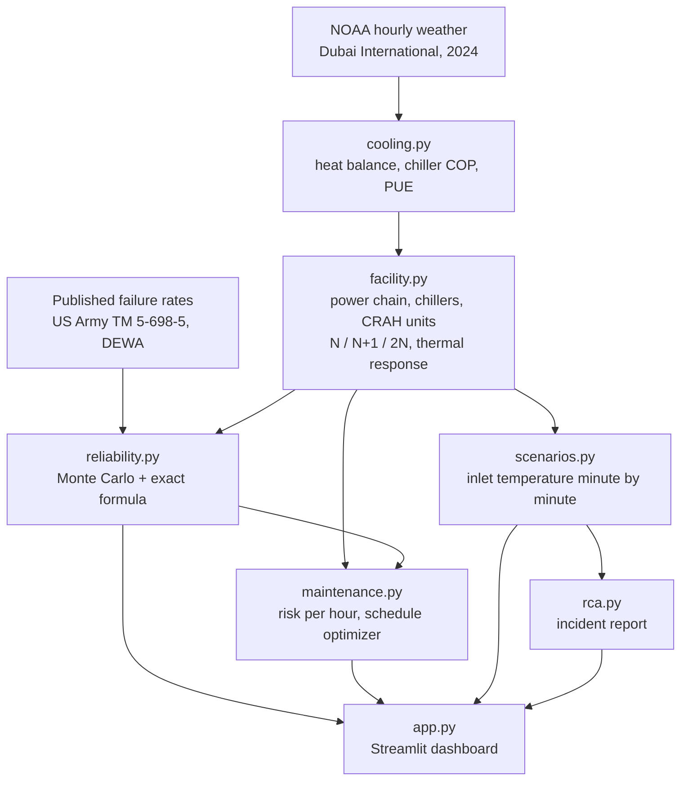

# Dubai Data Center Reliability Twin

**Question:** in a Dubai data hall, when can we safely take a cooling or power unit offline for maintenance, and what is the real risk of each redundancy design?

A model of a fictional 1 MW IT hall, driven by a real year of hourly Dubai weather and published equipment failure rates. **An educational model, not an engineering design.** Every failure scenario in it is hypothetical.

**Short answers**
- **Redundancy:** with exactly the units needed (N), the hall is short of cooling about once every 3.6 years and loses IT power about once every 14 years. One spare of each (N+1) pushes independent-failure events out to thousands of years. After that, the risk that remains is the kind extra units cannot fix: hidden faults, shared systems and the minutes after a power cut.
- **Maintenance timing:** a chiller job in the hottest hour of the year carries 2.2 times the risk of the same job in the coolest hour. Choosing the hours cuts the year's maintenance risk by 11% (same month, day shift) to 25% (any month, any hour) against a fixed 09:00 monthly schedule.
- **What actually hurts:** in the scenarios, an N+1 hall whose standby unit has a hidden fault behaves like an N hall; a hall without stored chilled water overheats in under 3 minutes after a power cut even when the generators start; and a fault shared by all chillers defeats N+1 and 2N equally.


## Architecture



| # | Module | File | Status |
|---|---|---|---|
| 1 | Facility model | `twin/facility.py`, `twin/cooling.py` | Done |
| 2 | Reliability engine | `twin/reliability.py` | Done |
| 3 | Maintenance-window optimizer | `twin/maintenance.py` | Done |
| 4 | Scenario lab | `twin/scenarios.py` | Done |
| 5 | Real telemetry from a home server | `telemetry/collector.py`, `twin/telemetry.py`, [docs/TELEMETRY.md](docs/TELEMETRY.md) | Code done; **no real data collected yet** |
| 6 | Automatic incident report | `twin/rca.py`, examples in `reports/` | Done |
| 7 | Dashboard | `app.py` | Done |

The hall: 1,000 kW of IT; chillers 2 needed x 700 kW; CRAH units 4 needed x 300 kW; UPS modules 2 needed x 600 kW; generators 2 needed x 800 kW; one transfer switch (two in N+1 and 2N).

## Data sources

| Source | Year | Used for |
|---|---|---|
| NOAA NCEI Integrated Surface Database, station 41194099999 Dubai International Airport | 2024 | Hourly outdoor temperature (8,401 of 8,784 hours measured; the rest estimated and flagged) |
| US Army TM 5-698-5, Appendix B (PREP database) | 2006 | Failures per year and repair hours: chiller 0.1182 / 12.62 (H10-000, p. B-4); air handling unit 0.0110 / 2.36 (H5-000, p. B-2); standby diesel generator 0.1235 / 18.28 (E18-122, p. B-6); UPS 0.00938 / 2.00 (E39-200, p. B-12); automatic transfer switch 0.05117 / 4.10 (E34-100, p. B-9) |
| DEWA Integrated Report | 2024 | Utility: 0.94 customer minutes lost per customer per year |
| ASHRAE TC 9.9, Thermal Guidelines for Data Processing Environments, 5th edition | 2021 | Server inlet: 18 to 27 C recommended (confirmed in the ASHRAE Journal, May 2022, and secondary summaries, not in the book itself); 32 C allowable for class A1 (secondary summaries only) |
| California Title 24 Part 6, Table 110.2-D | 2022 | Air-cooled chiller efficiency used to calibrate the chiller model (10.1 EER) |

The cooling physics is reused from [dubai-datacenter-cooling](https://github.com/dodo5037/dubai-datacenter-cooling).

## Key results

### Reliability (module 2): one million simulated years per design

| Design | Cooling shortfall | Cooling shortfall event | Loss of IT power |
|---|---|---|---|
| N | 3.1 hours a year | about once every 3.6 years | about once every 14 years |
| N+1 | 0.0007 hours a year | about once every 8,400 years | about once every 48,000 years |
| 2N | none in a million years | (exact formula: 2 x 10^-11 of the time) | about once every 370,000 years |

- In the N design, 72% of power-loss events come from the single transfer switch and 26% from the UPS; under 2% from the utility.
- Simulation against the exact formula, cooling unavailability for N: 3.511 x 10^-4 against 3.523 x 10^-4.
- For N+1 and 2N the events are too rare for simulation to count reliably (119 in a million years for N+1 cooling); the exact formula is the better number there.

### Maintenance windows (module 3): N+1 design

Risk of a maintenance hour = chance that a remaining unit fails in that hour x kW short if it does x 2 hours to restore the unit. Twelve chiller jobs of 8 hours and ten CRAH jobs of 4 hours a year.

| Schedule | Risk (expected kWh uncooled a year) | Change | Average outdoor temperature during jobs |
|---|---|---|---|
| Fixed: 09:00 on a set day each month | 2.22 | | 31.7 C |
| Same month, best day, day shift (07:00-17:00) | 1.98 | -11% | 26.4 C |
| Same month, best hours, any time of day | 1.85 | -17% | 24.5 C |
| Any month (60 days apart per unit), day shift | 1.82 | -18% | 22.8 C |
| Any month (60 days apart per unit), any time | 1.67 | -25% | 20.4 C |

The absolute risk is small, because a second independent failure inside a few hours is rare. Timing changes how bad a failure would be. The schedule is chosen with hindsight on 2024 weather, so the reductions are an upper bound.

### Scenario lab (module 4): 46 C outdoor, all hypothetical

| Scenario | Peak inlet | Reaches 27 C | Outcome |
|---|---|---|---|
| CRAH fails, N (no standby) | 30.5 C | after 2.2 min | Settles at 30.5 C until repaired |
| CRAH fails, N+1, standby works | 26.1 C | never | No impact |
| CRAH fails, N+1, standby has a hidden fault | 30.1 C | after 2.2 min | 12.5 min above 27 C, until a technician fixes it |
| Utility loss, one generator fails to start, N | 40 C | after 0.5 min | IT loses power when the battery runs out |
| Same, N+1, no chilled-water storage | 40 C | after 0.5 min | Power holds; servers overheat and shut down after 2.8 min |
| Same, N+1, 6-minute chilled-water tank | 27.7 C | after 0.5 min | Rides through |
| All chillers trip together, N+1 or 2N | 40 C | after 0.5 min | Servers shut down after 2.8 min in both designs |

### Incident reports (module 6)

Any scenario that passes 27 C or loses IT power produces a report in `reports/`: summary, impact, timeline, five whys, contributing factors, corrective and preventive actions with an owner and a verification each. Example: [standby CRAH with a hidden fault](reports/crah_failure_n_1_standby_hidden_fault.md). The numbers and timeline come from the simulation; the causes and actions come from a rule library of six event types. It is a template filled with data, not a diagnosis.

## Assumptions

Everything below is an assumption, not a measurement or a vendor figure. All are parameters in the code.

| Area | Assumption | Value |
|---|---|---|
| Hall | IT load, constant | 1,000 kW |
| Hall | Server inlet setpoint | 25 C |
| Hall | Heat gain from outside | 1.5 kW per K above the hall temperature |
| Hall | Thermal mass (air plus the equipment that warms in the first minutes) | 12,800 kJ/K |
| Hall | Servers shut down at an inlet of | 40 C |
| Cooling | Chiller capacity change with outdoor air | -1.2% per K above 35 C |
| Cooling | CRAH coil capacity | linear in (return air - chilled water) |
| Cooling | Chiller restart after a power interruption | 5 minutes |
| Cooling | Fans, pumps and chillers | not on UPS |
| Power | UPS battery at full load | 5 minutes |
| Power | Generators take load after | 30 seconds |
| Power | Chance a generator fails to start | 1% |
| Power | Utility interruptions | 0.1 a year (duration set so the total is 0.94 minutes a year) |
| Power | A failed transfer switch | means no power path |
| Reliability | Failures | independent, exponential times to failure and repair |
| Maintenance | Jobs | 4 x 8 h a year per chiller, 2 x 4 h per CRAH |
| Maintenance | Time to abort a job and restore the unit | 2 hours |
| Scenarios | Standby unit cooling after a failure | 1 minute |
| Scenarios | Technician finds and fixes a hidden fault | 12 minutes |
| Unit sizes | Chillers 700 kW, CRAH 300 kW, UPS 600 kW, generators 800 kW | sized so N units carry the hottest hour |

## Tests (45)

- **Physics:** heat balance for air and water, cooling load = all electricity in the hall plus outside gain, the chiller model reproduces its rating point, temperature rise = heat / thermal mass, units.
- **Reliability maths:** availability = MTBF / (MTBF + MTTR); "at least k of n" by hand; Monte Carlo against the exact formula for N, and for N+1 using deliberately unreliable test units so that double failures are frequent enough to count.
- **Optimizer:** every optimized schedule beats the fixed one; no two units of a kind offline together; day-shift and same-month rules hold; the method matches a brute-force search on a small case.
- **Scenarios, reports, dashboard:** no report without a breach; report numbers equal simulation numbers; the dashboard starts without an error.
- **Telemetry:** the collector reads a fake sensor tree, drops nonsense values and records nothing that identifies the machine; the fit recovers a known relationship and flags an injected spike. These use made-up test readings.

## Limits

- **Educational model, not an engineering design.** No vendor data, no site drawings, no real control logic.
- **Independent failures.** Common-cause failures and human error are only shown as scenarios, not in the probabilities. The N+1 and 2N figures are therefore a best case.
- **Old, non-local failure data** (US sites, before 2006). Air handling units stand in for CRAH units.
- **Standby generators** are judged by time-based availability plus an assumed start failure; real start reliability comes from test records.
- **One lumped temperature** for the whole hall: no hot spots, no airflow, no humidity.
- **One year of weather**, and the maintenance optimizer sees it in hindsight.
- **Constant IT load.**
- **Module 5 has code but no data yet.** The collector and the thermal-model fit are tested only on made-up test readings. Nothing here has been checked against real hardware until readings are collected.

## Run it

```bash
python3 -m venv .venv && source .venv/bin/activate && pip install -r requirements.txt
python -m pytest -q                 # 45 tests
python -m twin.reliability          # Monte Carlo, about 2 seconds for 200,000 years per design
python -m twin.maintenance          # schedules
python -m twin.scenarios            # scenario table
python -m twin.rca                  # writes reports/
streamlit run app.py                # dashboard
```

Author: Abderrahmane Messaoudi, Industrial Engineering & Engineering Management, University of Sharjah
