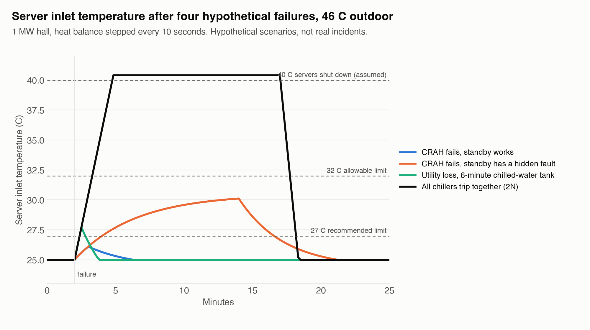

# Dubai Data Center Reliability Twin

**Question:** in a Dubai data hall, when can we safely take a cooling or power unit offline for maintenance, and what is the real risk of each redundancy design?

An educational model of a fictional 1 MW IT hall. **Not an engineering design.** Work in progress: modules are added one at a time.

| # | Module | Status |
|---|---|---|
| 1 | Facility model: power chain, cooling, N / N+1 / 2N, thermal response (`twin/facility.py`, `twin/cooling.py`) | Done |
| 2 | Reliability engine: Monte Carlo of failures and repairs, checked against the analytical answer (`twin/reliability.py`) | Done |
| 3 | Maintenance-window optimizer: lowest-risk hours to take each unit offline, against a fixed monthly schedule (`twin/maintenance.py`) | Done |
| 4 | Scenario lab: inlet temperature minute by minute after a failure (`twin/scenarios.py`) | Done |
| 5 | Real telemetry from a home server | Not started (waiting for server details) |
| 6 | Automatic incident report for any scenario that breaches a limit (`twin/rca.py`, examples in `reports/`) | Done |
| 7 | Dashboard: Streamlit app over all modules (`app.py`) | Done |

## Results so far (module 2)

One million simulated years per design. Failures are independent; common-cause failures are not modelled yet, so the N+1 and 2N figures are a best case.

| Design | Cooling shortfall | Cooling shortfall event | Loss of IT power |
|---|---|---|---|
| N | 3.1 hours a year | about once every 3.6 years | about once every 14 years |
| N+1 | 0.0007 hours a year | about once every 8,400 years | about once every 48,000 years |
| 2N | none in a million years | (analytical: 2 x 10^-11 of the time) | about once every 370,000 years |

- In the N design, 72% of power-loss events come from the single transfer switch and 26% from the UPS, not from the utility.
- The simulation agrees with the exact formula: cooling unavailability for N is 3.511 x 10^-4 simulated against 3.523 x 10^-4 analytical.
- For N+1 and 2N the events are so rare that simulation alone is unreliable; the analytical figure is the better number there.

### Module 3: when to do maintenance (N+1 design)

Risk of a maintenance hour = chance that one of the remaining units fails in that hour x kW of cooling short if it does x 2 hours to put the unit back. It is an expected amount of uncooled heat. 12 chiller jobs of 8 hours and 10 CRAH jobs of 4 hours a year.

| Schedule | Risk (expected kWh uncooled a year) | Change | Average outdoor temperature during jobs |
|---|---|---|---|
| Fixed: 09:00 on a set day each month | 2.22 | | 31.7 C |
| Same month, best day, day shift (07:00-17:00) | 1.98 | -11% | 26.4 C |
| Same month, best hours, any time of day | 1.85 | -17% | 24.5 C |
| Any month (60 days apart per unit), day shift | 1.82 | -18% | 22.8 C |
| Any month (60 days apart per unit), any time | 1.67 | -25% | 20.4 C |

- A chiller job in the hottest hour of the year carries 2.2 times the risk of the same job in the coolest hour. For CRAH units the ratio is 1.1: their capacity does not depend on the weather.
- The fixed schedule's worst job is the chiller job on 5 August at 09:00 (38.7 C average). The free schedule puts chiller jobs on winter nights (16 to 20 C).
- The absolute risk is small, because a second independent failure inside a few hours is rare. Timing changes how bad it would be, not whether N+1 is safe.
- The schedule is chosen with hindsight on the 2024 weather. A real planner has a forecast, so these reductions are an upper bound.

**Assumptions:** job counts and lengths (4 x 8 h per chiller, 2 x 4 h per CRAH); 2 hours to abort a job and restore the unit; constant IT load.

### Module 4: what a failure looks like, minute by minute (46 C outdoor, all hypothetical)



| Scenario | Peak inlet | Reaches 27 C | Reaches 32 C | Outcome |
|---|---|---|---|---|
| CRAH fails, N (no standby) | 30.5 C | after 2.2 min | never | Settles at 30.5 C until repaired |
| CRAH fails, N+1, standby works | 26.1 C | never | never | No impact |
| CRAH fails, N+1, standby has a hidden fault | 30.1 C | after 2.2 min | never | 12.5 min above 27 C, until a technician fixes it |
| Utility loss, one generator fails to start, N | 40 C | after 0.5 min | after 1.3 min | IT loses power when the battery runs out |
| Same, N+1, no chilled-water storage | 40 C | after 0.5 min | after 1.3 min | Power holds, but servers overheat and shut down after 2.8 min while the chillers restart |
| Same, N+1, 6-minute chilled-water tank | 27.7 C | after 0.5 min | never | Rides through |
| All chillers trip together (common mode), N+1 or 2N | 40 C | after 0.5 min | after 1.3 min | Servers shut down after 2.8 min; extra units make no difference |

- **A hidden fault erases redundancy.** An N+1 hall whose standby does not cool behaves exactly like an N hall until someone notices.
- **After a power cut, the chillers are the gap, not the generators.** Generators take the load in 30 seconds; chillers need 5 minutes to restart. Without stored chilled water the hall overheats in under 3 minutes even though power is back.
- **Redundancy does nothing against a shared failure.** N+1 and 2N give the same result when one fault stops every chiller.

**Assumptions:** thermal mass 12,800 kJ/K; a standby unit cools 1 minute after a failure; a technician needs 12 minutes to find and fix a hidden fault; generators take load in 30 s; chillers restart in 5 min; fans, pumps and chillers are not on UPS; servers shut down at a 40 C inlet; a CRAH coil's capacity grows linearly with the gap between return air and chilled water.

### Module 6: automatic incident report

Any scenario that takes the inlet above 27 C, or loses IT power, produces a report in `reports/`: summary, impact table, timeline, five whys, contributing factors, corrective and preventive actions with an owner and a verification each. Example: [standby CRAH with a hidden fault](reports/crah_failure_n_1_standby_hidden_fault.md).

The numbers and the timeline come from the simulation. The causes and actions come from a rule library with one entry per kind of event (six so far). It is a template filled with data, not a diagnosis, and every report is marked hypothetical.

**Failure data:** US Army TM 5-698-5 (22 July 2006), Appendix B: chiller H10-000 (0.1182 failures a year, 12.62 h repair, p. B-4), air handling unit H5-000 (0.0110, 2.36 h, p. B-2), standby diesel generator E18-122 (0.1235, 18.28 h, p. B-6), UPS E39-200 (0.00938, 2.00 h, p. B-12), automatic transfer switch E34-100 (0.05117, 4.10 h, p. B-9). **Utility:** DEWA reports 0.94 customer minutes lost per customer in 2024 (DEWA Integrated Report 2024).

**Assumptions:** 0.1 utility interruptions a year (DEWA does not publish frequency; the mean duration is set so the total is 0.94 minutes); each generator has a 1% chance of not starting; a failed transfer switch means no power path; 5 minutes of UPS battery.

Weather: NOAA Integrated Surface Database, Dubai International Airport, 2024, hourly. The cooling physics is reused from [dubai-datacenter-cooling](https://github.com/dodo5037/dubai-datacenter-cooling).

```bash
python3 -m venv .venv && source .venv/bin/activate && pip install -r requirements.txt
python -m pytest -q          # 38 tests
streamlit run app.py         # dashboard on http://localhost:8501
```

Author: Abderrahmane Messaoudi, Industrial Engineering & Engineering Management, University of Sharjah
